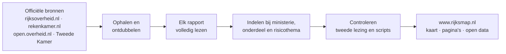

# Rijksmap

**De rijksoverheid in kaart.** De Rijksmap laat in één overzicht zien hoe de Nederlandse rijksoverheid is opgebouwd, wie haar leidt, en wat auditors, inspecties en onderzoekers er sinds 2019 over hebben gerapporteerd.

**→ Bekijk de kaart op [www.rijksmap.nl](https://www.rijksmap.nl)**

---

## Wat je op de kaart vindt

- **De twaalf ministeries:** bewindspersonen, bestuursraad, directoraten-generaal, directies en uitvoeringsdiensten (ook ZBO's en RWT's), met links naar de officiële bronnen.
- **Ruim 9.000 rapporten** uit vier bronnen: de Auditdienst Rijk (ADR), de Algemene Rekenkamer, de rijksinspecties en toezichthouders, en overig onderzoek en evaluaties. Elk rapport hangt bij het onderdeel waar het over gaat.
- **Risicothema's:** elk rapport is ingedeeld op de zestien risicocategorieën van [Risk in Focus 2026](https://www.iia.nl/bijlagen/7cd962d0-655b-443b-b735-3be9dbfd98b4/download), met per rapport een korte onderbouwing.
- **Zoeken, filteren en exporteren:** op jaar, bron, onderdeel, risicothema of zoekwoord, en elke selectie als Excel, CSV of JSON.

Elk getal en elk label linkt door naar de officiële publicatie.

## Open data

De volledige dataset is vrij te gebruiken onder [CC0](https://creativecommons.org/publicdomain/zero/1.0/):

| Bestand | Inhoud |
| --- | --- |
| [`rijksmap-rapporten.csv`](https://www.rijksmap.nl/rijksmap-rapporten.csv) | Alle rapporten, één regel per rapport (opent direct in Excel) |
| [`rijksmap-rapporten.json`](https://www.rijksmap.nl/rijksmap-rapporten.json) | Dezelfde data, met een toelichting per veld |

Wat elk veld betekent en waar het vandaan komt, staat in het [datamodel](docs/datamodel.md).

## Hoe het werkt



1. **Ophalen.** Rapporten worden opgehaald bij de officiële bronnen en ontdubbeld.
2. **Lezen.** Elk openbaar rapport wordt volledig gelezen door een AI-model (Claude van Anthropic), volgens vaste [leesprotocollen](docs/protocollen/).
3. **Indelen.** Het rapport wordt gekoppeld aan het ministerie en onderdeel waar het over gaat, en krijgt risicothema's met een onderbouwing.
4. **Controleren.** Een tweede model beoordeelt de uitkomsten, en scripts controleren op fouten, dubbelingen en verzonnen inhoud. Nieuwe gegevens komen pas op de kaart als ze alle controles halen.
5. **Publiceren.** De kaart, een pagina per rapport en per onderdeel, en de open data.

Waar de uitgever een eigen samenvatting publiceert, wordt die overgenomen. Datum, titel, auteur en link komen altijd uit de officiële bron.

## Documentatie

| Document | Waarover |
| --- | --- |
| [Pijplijn en kwaliteitsborging](docs/pijplijn-en-kwaliteit.md) | Hoe rapporten worden opgehaald, gelezen, ingedeeld en gecontroleerd, en hoe betrouwbaar de indeling is |
| [Leesprotocollen](docs/protocollen/) | De letterlijke instructies voor de AI-lezers |
| [Datamodel](docs/datamodel.md) | Alle velden in de open data |
| [Architectuur](docs/architectuur.md) | Hoe de website is gebouwd |
| [Routekaart](docs/routekaart.md) | Wat er nog komt |
| [Versiegeschiedenis](CHANGELOG.md) | Wat er per release is veranderd |

## Volgende stap

De kaart is nu één groot HTML-bestand (circa 10 MB) waarin alle data zit. Dat is eenvoudig te hosten, maar groeit niet goed mee. De volgende stap is een applicatie met een database, zodat de kaart alleen laadt wat je bekijkt en de data rechtstreeks te bevragen is. Ook door AI-agents: via het [Model Context Protocol (MCP)](https://modelcontextprotocol.io) kan iedereen straks een eigen agent de rapporten laten doorzoeken. Zie de [routekaart](docs/routekaart.md).

## Wat er in deze repository staat

```
/
├── index.html                  de interactieve kaart
├── <ministerie>/               een pagina per ministerie en onderdeel
├── rapport/                    een pagina per rapport
├── rijksmap-rapporten.csv      open data
├── rijksmap-rapporten.json     open data met veldtoelichting
├── rijksmap-rfo.json           onderbouwingen bij de risicothema's (laadt de kaart op aanvraag)
├── sitemap.xml, robots.txt     voor zoekmachines
├── checksum.txt                controlegetal (SHA-256) van index.html
├── docs/                       documentatie en leesprotocollen
└── CNAME                       koppelt de site aan www.rijksmap.nl
```

De complete website is ook als één zip te downloaden bij de [releases](../../releases).

## Meedoen

Zie je een fout, zoals een rapport bij het verkeerde onderdeel of een verouderde bewindspersoon? [Meld het via een issue](../../issues/new/choose) of mail naar [info@rijksmap.nl](mailto:info@rijksmap.nl). Meer in [CONTRIBUTING.md](CONTRIBUTING.md).

## Goed om te weten

- De risicothema's zijn een hulpmiddel om rapporten te vinden en te vergelijken, geen oordeel van de ADR, de Rekenkamer, de inspecties of de ministeries.
- Aantallen laten zien hoeveel er over een onderwerp is onderzocht, niet hoe goed het ervoor staat.
- De kaart toont alleen zakelijke, openbare functiegegevens. Wie vermeld staat, kan correctie of verwijdering vragen via [info@rijksmap.nl](mailto:info@rijksmap.nl).

## Licentie

- **Code:** [PolyForm Noncommercial 1.0.0](LICENSE.md): vrij te gebruiken, aan te passen en te delen, niet voor commercieel gebruik.
- **Data:** [CC0 1.0](https://creativecommons.org/publicdomain/zero/1.0/): vrij te gebruiken; bronvermelding wordt gewaardeerd.

## Over

De Rijksmap is een persoonlijk initiatief van **Robert Worm**, gemaakt uit nieuwsgierigheid naar hoe de rijksoverheid in elkaar zit. Geen officiële uiting van de rijksoverheid. · [LinkedIn](https://linkedin.com/in/robertworm) · [info@rijksmap.nl](mailto:info@rijksmap.nl)
