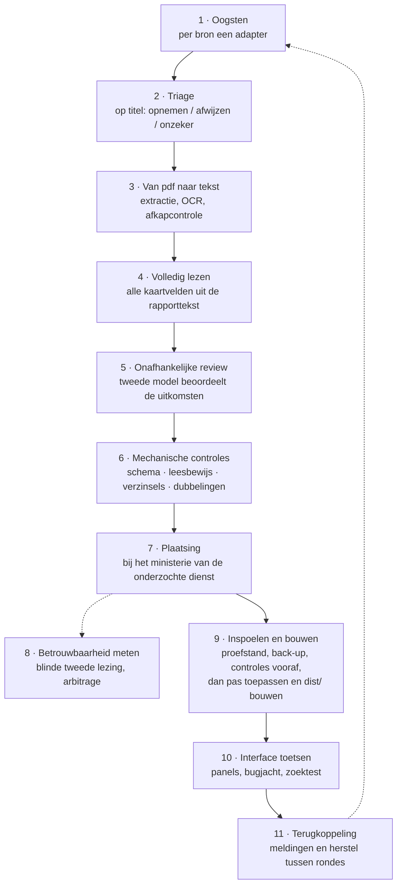

# Pijplijn en kwaliteitsborging

Deze pagina beschrijft hoe een rapport van een officiële website in de Rijksmap komt, en wat er wordt gedaan om te zorgen dat het klopt. De pijplijn draait in bijwerkrondes met [Claude Code](https://claude.com/claude-code). AI-agents doen het lees-, classificeer- en controlewerk volgens schriftelijk vastgelegde [protocollen](protocollen/), Node.js-scripts bewaken het resultaat, en de maker neemt de besluiten.

## Uitgangspunten

1. **De automaat doet voorstellen, hij past niets toe.** Ophalen, lezen en controleren levert een voorstel op. Toepassen op de kaart is een aparte, bewuste stap, en alleen voor voorstellen die alle poorten halen.
2. **Stilte is geen zekerheid.** Per bron wordt bijgehouden of het lezen *gelukt* is, *niets gevonden* heeft, of *niet kon lezen*. Dat laatste blijft zichtbaar, anders leest een mislukte ophaalronde als "geen wijzigingen".
3. **Verzin niets.** Wat niet in het rapport staat, blijft leeg. Liever "onzeker" dan gokken, liever geen label dan een gezocht label.
4. **De officiële bron is leidend.** Officiële omschrijvingen worden nooit vervangen door gegenereerde tekst. Bij verschillen tussen bronnen wint de meest recente officiële publicatie.
5. **Elke stap is herleidbaar.** Elk oordeel heeft een onderbouwing, een model en een bestand waarin het is vastgelegd. Voor elke wijziging van de kaart wordt een back-up gemaakt.

## Overzicht

## 1 · Oogsten

`bijwerken.mjs` haalt per bron nieuwe kandidaten op en vergelijkt ze met de kaart. Elke bron heeft een eigen adapter:

| Bron | Route |
| --- | --- |
| Auditdienst Rijk | de rapportenindex per ministerie op rijksoverheid.nl, plus een tweede route via open.overheid.nl |
| Algemene Rekenkamer | het documentenregister op rekenkamer.nl |
| Rijksinspecties en externe onderzoeksbureaus | open.overheid.nl en rijksoverheid.nl |
| Planbureaus (CPB, SCP, PBL) | hun eigen websites |
| Bijlagen bij Kamerbrieven | het open dataportaal van de Tweede Kamer |
| Organisatie en leiding | organogrammen, introductiedossiers voor bewindspersonen, ABD-benoemingsberichten ([methode](protocollen/benoemingen-zoeken.md)) |

Elke bron heeft een eigen route naar het bestand. Een paar voorbeelden: op open.overheid.nl wordt `/details/<id>` omgezet naar `/documenten/<id>/pdf`; de Rekenkamer vraagt twee stappen (documentpagina, dan `/site/binaries/...`); en de SCP-repository werkt met ondertekende, verlopende adressen.

De ophaler werkt bewust **traag en herkenbaar**: één verzoek per host tegelijk, een pauze ertussen en een eigen User-Agent (`Rijksmap-bijwerken/1.0 (info@rijksmap.nl)`), zodat een beheerder in zijn logboek ziet wie er langskomt. Het geheel is hervatbaar: wat er al ligt, wordt overgeslagen.

Drie controles voorkomen stille vervuiling:

- **PDF-handtekening.** Een foutpagina komt vaak terug met status 200. Elk bestand wordt daarom getoetst op de PDF-handtekening aan het begin; wat die mist, telt als mislukt en niet als rapport.
- **Soort mislukking.** Een tijdelijke storing krijgt een nieuwe poging; een structureel gesloten deur gaat meteen naar een andere route.
- **Poorten in het ophaalscript.** Is de nieuwe link echt bereikbaar? En zijn rapporten die als "nog niet gepubliceerd" bekendstonden inmiddels verschenen (de np-hercontrole)?

Adressen worden vóór vergelijking genormaliseerd: host weg, accenten gevouwen. De bron levert accentloze adressen, de kaart soms niet. Zonder die stap kwam dezelfde publicatie als "nieuw" langs: 30 valse treffers in de eerste proefronde, die tegelijk 30 dode links in de kaart blootlegden.

**Afbakening.** Bij inspecties en onderzoek telt een rapport alleen mee als het een rijksorganisatie of rijksbeleid onderzoekt. Toezicht op één school, één ziekenhuis of één bedrijf valt erbuiten.

## 2 · Triage

Grote oogsten worden eerst op titel en datum beoordeeld ([protocol](protocollen/triage-kamerbijlagen.md)). Het besluit is `opnemen`, `afwijzen` (met verplichte reden) of `onzeker`. Uitdrukkelijk buiten scope vallen onder meer wetgevingsadviezen, uitvoeringstoetsen, kabinetsstukken, EU-documenten, procesbijlagen en rapporten zonder rijksorganisatie als onderwerp.

De omvang laat zien hoe streng dit filter is. Bij de veegactie over de Kamerbijlagen in augustus 2026:

| Stap | Aantal |
| --- | ---: |
| Bijlagen bij Kamerbrieven sinds 2019 | 75.339 |
| Kandidaten na triage | 12.371 |
| Volledig gelezen | 5.035 |
| Opgenomen na kwaliteitscontrole en ontdubbeling | 4.454 |

Over alle bronnen samen zijn uit **9.839 vondsten** in meerdere controlerondes de dubbelingen, niet-rapporten en stukken buiten de afbakening gefilterd.

## 3 · Van pdf naar tekst

Van de 9.085 unieke rapporten staat **99,2%** als pdf in het bronarchief en is **99,4%** beschikbaar als doorzoekbare tekst. De 56 die ontbreken, zijn gedocumenteerd: 30 harde fouten bij de bron, 25 zonder ophaaladres in de brondata en één structureel kapot bestand.

- **Extractie met mupdf, onder een herstartlus.** Bij een beschadigde pdf valt mupdf (WebAssembly) onherstelbaar om; dat is geen vangbare fout, het proces is gewoon weg. Bij duizenden bestanden is dat geen randgeval maar een zekerheid. De extractie draait daarom in een lus die telkens opnieuw start en overslaat wat al klaar is. Over het hele corpus waren 46 herstarts nodig.
- **OCR voor scans** (tesseract.js, Nederlands taalmodel). Binnen één lang proces liep het geheugen vol, dus krijgt elk rapport een vers proces, met een tweede poging op lagere resolutie als dat nodig is. Zo kwamen 181 van de 182 scans alsnog binnen.
- **Archief en werkset gescheiden.** De teksten (ruim 1 GB) zijn wat steeds gelezen wordt; de bron-pdf's (21 GB) zijn archief dat je één keer nodig hebt en daarna bewaart.
- **Afgekapte teksten opsporen.** Scripts zoeken teksten die halverwege stoppen. Afgekapte Rekenkamerteksten zijn opnieuw opgehaald voordat ze werden gelezen, en lezers melden zelf als een tekst eerder ophoudt dan het colofon belooft.

## 4 · Volledig lezen

Elke kandidaat die de triage haalt, wordt **van begin tot eind gelezen**. De lezer vult per rapport alle kaartvelden in ([protocol](protocollen/lezen-kamerbijlagen.md)):

- de **echte titel** van de titelpagina (de omschrijving van een Kamerbijlage is vaak iets anders)
- de **publicatiedatum volgens het colofon** (de registratiedatum bij de Kamer loopt vaak maanden achter; wijkt die meer dan een half jaar af, dan wordt dat gemeld)
- het **ministerie en onderdeel** van het onderzochte beleid of de onderzochte organisatie
- auteur, opdrachtgever, rapporttype, onderzochte periode en centrale wet
- de **methodische standaard**, alleen als die dragend wordt genoemd ([protocol](protocollen/standaard-bepalen.md))
- 1 tot 3 **risicocodes** met een onderbouwing die in de tekst verankerd is
- een **samenvatting** van 400 tot 900 tekens, alleen als er geen officiële omschrijving is
- een **twijfelveld** voor de maker; blijkt het bij lezing toch geen rapport, of is de tekst onbruikbaar, dan wordt de regel afgevoerd in plaats van ingevuld

Samenvattingen hebben eigen eisen ([protocol](protocollen/samenvatting-schrijven.md)): wat is onderzocht en door wie, de belangrijkste bevindingen **met concrete gegevens uit de tekst**, en de conclusie. Ze zijn zakelijk en neutraal, met zinnen van gemiddeld minder dan 20 woorden, en herhalen de titel niet. Een samenvatting zonder één concreet gegeven uit het rapport wordt afgekeurd. Is de tekst onbruikbaar, dan wordt er niets geschreven: nooit inhoud verzinnen op basis van de titel.

## 5 · Onafhankelijke review

Een tweede model beoordeelt de uitkomsten van de leesronde ([protocol](protocollen/review-kamerbijlagen.md)), zonder de rapporten opnieuw te lezen. Het let op:

- ministerietoewijzing, ook **tussen** rijen: worden vergelijkbare rapporten verschillend ingedeeld?
- scope: horen afgevoerde of opgenomen rijen er echt (niet) bij?
- consistentie van rapporttype binnen reeksen
- of de risicolabels stroken met titel, samenvatting en onderbouwing
- neutrale, feitelijke samenvattingen zonder verzonnen precisie
- dubbelingen, reeksdelen en hoofdrapport-plus-samenvatting
- vreemde datums, en of het standaardveld echt een methodische standaard bevat
- patronen op datasetniveau, zoals verschil in strengheid tussen twee lezers

Elke bevinding heeft een documentnummer, een ernst en een zekerheid. In de laatste veegactie leverde deze review **1.262 bevindingen** op, die vóór publicatie zijn afgehandeld.

## 6 · Mechanische controles

Scripts controleren wat modellen niet zelf kunnen garanderen:

| Controle | Script | Wat het vangt |
| --- | --- | --- |
| **Schema** | `bijwerken-valideer.mjs`, `oo-review-qc.mjs` | Ongeldige risicosleutels of ministeriecodes, primair risico niet in de lijst, meer dan vier labels, te korte velden. Een oordeel dat hier faalt, wordt niet toegepast. |
| **Leesbewijs** | `bijwerken-leesbewijs.mjs` | Of een lezer het rapport echt heeft gelezen of alleen de meegeleverde omschrijving herschreef. Gemeten via woordoverlap met de omschrijving, en via concrete feiten in de samenvatting (getallen, bedragen, jaartallen) die niet in de omschrijving staan en dus uit het document moeten komen. |
| **Verzinsels** | `oo-review-verzonnen.mjs` | Oordelen die niet uit de brontekst kunnen komen. Op 1 augustus 2026 bleken negen rapporten met een lege tekstlaag toch een uitgebreide onderbouwing te hebben. Sindsdien wordt elk oordeel apart gezet dat op minder dan 500 tekens brontekst rust maar labels of een substantiële onderbouwing heeft. |
| **Dubbelingen** | `bijwerken-dedup.mjs`, `oo-review-qc.mjs` | Dezelfde publicatie op twee plekken (rijksoverheid.nl en open.overheid.nl), met licht andere titel. Vergeleken op genormaliseerde titel, jaar en plaats, tegen de hele kaart én binnen de nieuwe set. |
| **Reeksen** | `oo-review-qc.mjs` | Delen van dezelfde reeks horen op dezelfde plek. |
| **Eindcontrole** | `bijwerken-kwaliteit.mjs`, `bijwerken-eindcontrole.mjs` | Of oorspronkelijk oordeel, aangevulde metadata en herzieningen samen voor elk rapport een volledig, consistent record opleveren, en of elk in-scope rapport ook echt gelezen is. |
| **Datahygiëne** | `tk-datahygiene.mjs` | Plaatsvervangende datums (dag 01 voor "ergens die maand"). Ruim 1.500 regels zijn gemarkeerd met `datum_precisie`, zodat de site nooit meer precisie toont dan er is. |
| **Koppelingsaudit** | `audit-koppeling.mjs` | Rapporten bij het verkeerde onderdeel. Leverde onder meer 5 dubbelingen en 62 hertaggingen op. |
| **Beschrijvingsaudit** | `beschrijving-audit.mjs` | Organisatiebeschrijvingen die van hun officiële bron afwijken; 295 gecontroleerd. |
| **Benoemingspoorten** | `bijwerken-benoemingen.mjs` | Zes toetsen voordat een naam aan een functie wordt gekoppeld, waaronder of het benoemingsbericht het juiste departement noemt en of de persoon er aantoonbaar nog zit. |
| **Herbouwbare werklijst** | | Eén script bouwt de werklijst uit de brondata; alle andere lezen haar alleen. Elke afwijking tussen schijf en administratie valt zo op, en een beschadigde werklijst is in minuten te herbouwen. |
| **Stijl** | `maak-dist.mjs` | Geen em-dashes, geen JavaScript-fouten. De build stopt bij een overtreding. |

## 7 · Plaatsing

Twee regels bepalen waar een rapport staat:

- **De bron volgt de auteur, niet de vindplaats.** Wie een rapport schreef, bepaalt onder welke bronknop het valt. Een ADR-rapport op rijksoverheid.nl blijft een ADR-rapport. Zonder die regel toont een bronfilter wat toevallig op één website stond.
- **Het onderdeel volgt de rapporttekst, niet de vindplaats.** Zie hieronder.

Een rapport hoort bij het ministerie waar de **onderzochte dienst** onder valt, niet bij het ministerie waar de bron het toevallig publiceerde (besluit van 24 juli 2026). Voorbeeld: het auditrapport over het CJIB stond alleen op de indexpagina van Financiën, maar het CJIB is een dienst van Justitie en Veiligheid.

`bijwerken-plaatsing.mjs` past dat toe, en vangt drie valkuilen af:

- **Generieke namen.** "Directie Financieel-Economische Zaken" bestaat bij bijna elk ministerie en wijst dus niets aan. Zulke namen staan op een zwarte lijst.
- **Meerdere organisaties.** De eerstgenoemde organisatie is het onderwerp, de rest is betrokkene.
- **Lege dienstvelden.** Dan wordt de dienst uit de titel gelezen ("Auditrapport 2025 Centraal Justitieel Incassobureau").

Het onderdeel wordt alleen toegekend bij een ondubbelzinnige match. **Beter op het kerndepartement dan bij de verkeerde dienst.** De plaatsing is twee keer integraal herzien: in juli 2026 is de koppeling van álle rapporten getoetst aan de rapportteksten, en in augustus 2026 zijn ruim 2.000 rapporten van *Kerndepartement* naar het juiste directoraat-generaal of de juiste dienst verplaatst. Het aandeel in de restbak "kern of onbepaald" daalde daarmee van 59% naar minder dan 10%.

**Ontdubbelen over bronnen heen.** Hetzelfde rapport duikt op meerdere plekken op. Een les die geld kostte: twee scripts maakten elk hun eigen bestandsnaam uit dezelfde titel, met net een andere schrijfwijze (`dienstauto-s` tegenover `dienstautos`). Gevolg: 522 bestanden die bij geen enkele regel hoorden. De oplossing is structureel: één gedeelde naamfunctie die alle scripts gebruiken.

## 8 · Betrouwbaarheid gemeten

Een onderbouwing per label laat zien *waarom* een model iets vond. Of een ander model hetzelfde zou vinden, is een aparte vraag. Die wordt gemeten.

### Risicolabels: blinde tweede lezing

Een steekproef van rapporten is **blind** opnieuw geclassificeerd door een tweede model ([protocol](protocollen/meting-blinde-tweede-lezing.md)). Die lezer kreeg de bestaande labels niet te zien en mocht niets anders raadplegen dan de rapporttekst. De uitkomst van de eerste meting (Opus 4.8 tegenover Fable 5, 272 rapporten, berekend met `irr-bereken.mjs`):

| Maat | Uitkomst |
| --- | ---: |
| Overeenstemming op het primaire risico | 64,7% |
| Cohen's kappa op het primaire risico (kans 21%) | 0,55, "redelijk" volgens Landis & Koch |
| Gemiddelde Jaccard-overlap van de labelsets | 0,59 |
| Gemiddelde kappa per label | 0,59 |

Per label verschilt de overeenstemming sterk. `climate` (0,86), `cyber` (0,79) en `fraud` (0,75) zijn robuust. `continuity` (0,35) en `digital` (0,24) zijn dat niet: daar trekken de modellen de grens verschillend.

Waar de twee lezers verschilden, besliste een **scheidsrechter** die de volledige tekst las en niet wist welk model welke lezing gaf ([protocol](protocollen/meting-arbitrage.md)). De beslisregels zijn vastgelegd, bijvoorbeeld voor het grensgeval financieel tegenover governance bij auditrapporten. Inmiddels zijn ruim 770 rapporten in deze meting betrokken.

### Proef met een ander model en een andere aanbieder

Voor een rijkere duiding per rapport (strekking, oordeel, reikwijdte) liep in augustus 2026 een pilot op 100 rapporten met **drie lezers**: Fable 5, Opus 5 en een model van OpenAI ([protocol](protocollen/pilot-strekking.md), [instructie](protocollen/pilot-strekking-instructie-openai.md)). De OpenAI-lezer kreeg een afgesloten leespakket met SHA-256-hashes per tekst, zodat aantoonbaar is dat alle modellen identieke teksten lazen. De drempels voor opschalen zijn **vooraf** vastgelegd: kappa ≥ 0,75 om op te schalen, 0,55 tot 0,75 om de rubriek aan te scherpen, en onder 0,55 opnieuw ontwerpen. Gemeten is met Cohen's kappa én Gwet's AC1.

De uitkomst is eerlijk gerapporteerd. Binnen de modelfamilie was de rubriek goed reproduceerbaar (kappa 0,86), maar tussen aanbieders kwam de strekking uit op kappa 0,52: net onder de vooraf gestelde drempel. Een onafhankelijk eindpanel concludeerde daarom **"nog niet"**: de inhoud was sterk (geen feitelijke fouten in de diepgetoetste records), maar de bewijsvoering nog niet sterk genoeg om op te schalen. De vervolgstappen staan in de [routekaart](routekaart.md).

### Verdiepend leesproject: wat convergeert, en wat niet

In een verdiepend leesproject wordt per rapport veel fijnmaziger vastgelegd dan op de kaart (bewijsklasse, maatregelstatus, fase, wie iets vaststelde). Ook daar zijn rapporten twee keer blind gelezen. Die cijfers zeggen vooral iets over de methode, niet rechtstreeks over de kaartlabels. Er wordt bewust **kappa** gerapporteerd en niet alleen het ruwe percentage: bij een scheve verdeling haalt blind gokken al 89%.

| Veld | Ruw | Kappa | Oordeel |
| --- | ---: | ---: | --- |
| bewijsklasse | 95% | 0,58 | zwak |
| maatregelstatus | 57% | 0,40 | zwak |
| fase | 55% | 0,38 | onbruikbaar |
| wie stelde vast | 87% | 0,34 | onbruikbaar |
| soort organisatie | 18% | 0,13 | onbruikbaar |

De belangrijkste uitkomst is methodisch. Of twee lezers overeenkomen, hangt niet af van de vraag of een veld een feit of een oordeel bevat, maar van de vraag of het **een gesloten lijst** heeft. Vrije tekstvelden groeien mee met het volume, ook puur feitelijke. Gesloten lijsten verzadigen vrijwel direct: toen één veld werd dichtgezet, ging het van 59 unieke waarden op 60 records naar 5 op 29. Daarom werken de [leesprotocollen](protocollen/) zoveel mogelijk met vaste waardelijsten.

### Steekproeven tegen de bron

`qa-sample.mjs` trekt een gestratificeerde steekproef, met extra gewicht op labels met lage zekerheid. Het haalt de echte brontekst uit de pdf en maakt een invulbaar beoordelingsblad om de classificatie tegen het rapport te toetsen.

## 9 · Inspoelen en bouwen

- **Proefstand eerst.** `bijwerken-inspoelen.mjs` laat zonder `--toepassen` alleen zien wat er zou veranderen. Met `--toepassen` maakt het eerst een back-up en schrijft het daarna pas de kaart.
- **Lijstregels worden bijgewerkt, niet verdubbeld.** Rapporten die al in de kaart stonden als regel uit een halfjaarlijkse overzichtslijst, krijgen hun echte datum en adres in plaats van een tweede regel.
- **De build controleert eerst.** `maak-dist.mjs` stopt bij fouten, bouwt `dist/` volledig opnieuw, en breekt af bij dode verwijzingen of ontbrekende bestanden.

## 10 · De interface wordt net zo getoetst

- **Reviewpanels** (6 en 7 augustus 2026) beoordeelden de kaart vanuit vier lenzen: UX, toegankelijkheid, zoektechnologie en datajournalistiek. Bevindingen zijn teruggebouwd en in de code gedocumenteerd. Een voorbeeld: korte zoektermen matchen alleen hele woorden, zodat "AI" niet langer "AIVD" of "Airport" vindt, terwijl "AI-verordening" wel vindbaar blijft.
- **`zoektest.mjs`** speelt de zoeklogica van de kaart letterlijk na en geeft per treffer aan welk veld matchte. Daarmee is de precisie onderzocht met tientallen realistische zoektermen per ronde.
- **Bugjacht** (23 augustus 2026). Vier parallelle bugjagers (JavaScript-logica, CSS en thema's, bouwscripts, data tegenover interface), plus live browsertests. Elke vondst kreeg een reproductiescenario. Voorbeelden: weergaven die de browser 5 tot 8 seconden bevroren, toetsenbordbediening die dubbel klikte, een chip "undefined" die de matrix leegmaakte, en een "spring naar rapport" die voor 80% van de rapporten stil faalde. Alles is hersteld en in de code gemarkeerd.
- **WCAG-pass** op contrast, aria-attributen, toetsenbordnavigatie en landmarks.

## 11 · Terugkoppeling

Bij elk rapport in de kaart staat een knop om een **mogelijk onjuiste classificatie** te melden. Die opent een vooraf ingevulde mail met het rapport, de labels en het gebruikte model. Gemelde fouten worden ook tussen de rondes door hersteld. Wie als persoon vermeld staat, kan correctie, bezwaar of verwijdering vragen (AVG art. 16, 17 en 21) en krijgt binnen vier weken een inhoudelijk antwoord. Correcties via GitHub kunnen met de [issue-formulieren](../../../issues/new/choose).

## Harde lessen

Zes regels die uit fouten zijn ontstaan, niet uit theorie:

1. **Eén bron van waarheid per gegeven.** Twee scripts die bijna hetzelfde doen, zijn geen dubbeling maar een tijdbom. Ze lopen pas uiteen als er genoeg gevallen zijn, en dan is het al gebeurd.
2. **Alles afleidbaar maken.** Toen de schijf volliep, brak een schrijfactie af en werd de werklijst tot nul bytes afgekapt. Herstel kostte minuten, omdat ze volledig uit de brondata te herbouwen was.
3. **Verwacht dat het gereedschap omvalt.** Niet óf mupdf crasht, maar wanneer. Bouw de herstartlus voordat je hem nodig hebt.
4. **Bewaar de letterlijke bron naast de bewerking.** Een nieuwe codering over een bewaarde passage is achteraf toe te wijzen; een nieuw feit vraagt herlezen.
5. **Bevries het schema tijdens een ronde.** Drie instructieversies in twee dagen maakten 61% van de waarnemingen onvergelijkbaar. Eén telling las daardoor 16% waar het over de juiste noemer 39% was.
6. **Plan nooit een tweede doorgang over de bronbestanden.** Inlezen is veruit de duurste stap; opschrijven is bijna gratis. Dus één doorgang over de pdf's, en alle vervolgstappen over de oogst.

En drie houdingen die overal terugkomen:

- **Juistheid boven volledigheid.** Wat niet verifieerbaar is, blijft leeg. Een leeg veld is informatie, een gegokt veld is schade.
- **Bij twijfel niet koppelen.** Een ontbrekend rapport is zichtbaar, een verkeerd gekoppeld rapport niet.
- **Proefstand eerst.** Elk script dat iets verandert, toont eerst wat het zóu doen.

## Wat (nog) niet is geborgd

- **Geen stelselmatige menselijke validatie.** Er is overeenstemming tussen modellen gemeten, maar nog geen menselijk anker. Een blind, menselijk beoordeelde referentieset staat bovenaan de routekaart.
- **Overeenstemming binnen één modelfamilie is een bovengrens**, geen bewijs van juistheid. Daarom de cross-vendormeting.
- **Een classificatie is een hulpindeling,** geen oordeel van de betrokken instantie.
- **Volledig binnen wat openbaar en vindbaar is.** Een veegactie bewijst nooit dat er niets is gemist, alleen dat deze routes zijn uitgeput. Woo-geweigerde rapporten tellen mee maar zijn niet gelezen; staatsgeheim materiaal ontbreekt per definitie.
- **De tellingen zijn samengesteld, niet overgenomen.** Ze zijn ontdubbeld over bronnen en per onderdeel toegewezen op basis van de rapporttekst. Elk rapport linkt naar zijn bron, dus iedereen kan natellen.
- **Geen continuïteitsgarantie.** Dit is een particulier initiatief. De volledige dataset is als open data te downloaden en de kaart is een zelfstandig bestand dat iedereen kan archiveren.
